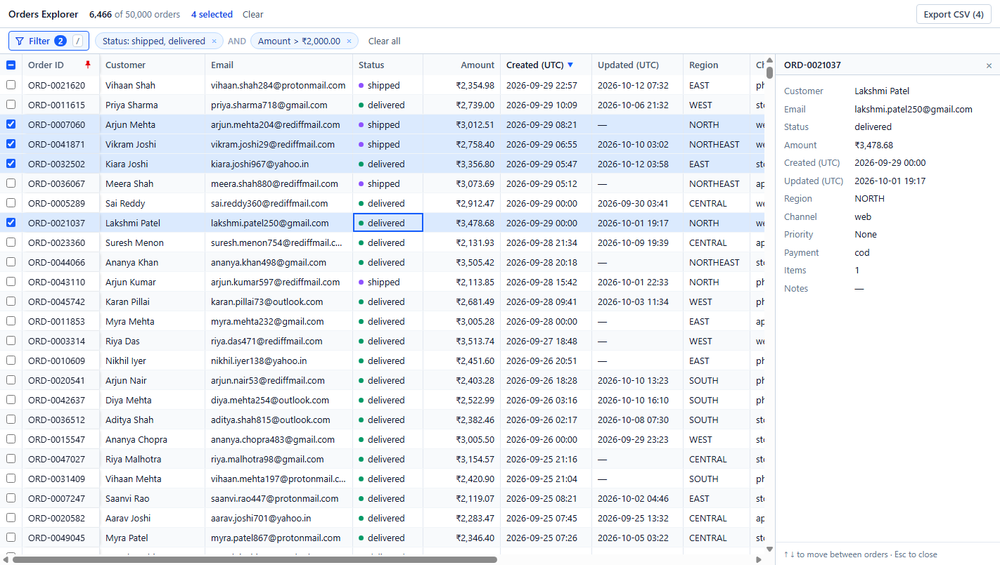
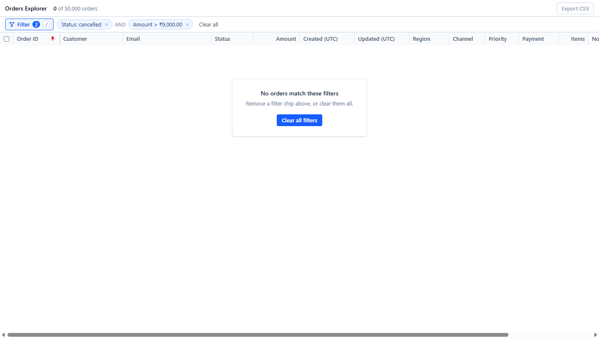

# Orders Explorer

A single-screen internal tool for browsing ~50,000 orders: a virtualized data grid plus a filter builder, with the whole view stored in the URL. React + TypeScript + Vite. The grid, virtualization and filter builder are written from scratch, with no table, virtualization or query-builder libraries.

## How to run

Requires **Node 24** (`engines` is set in `package.json`).

```bash
npm install
npm run dev        # http://localhost:5173
```

Other scripts:

```bash
npm run build      # type-check + production build into dist/
npm run preview    # serve the production build
npm run lint
```

## Screenshots

**Main screen:** filter chips, sorted by Created, 4 rows selected, details panel open.



**Empty state:** the filter matches nothing.




## Dependencies

Runtime:

- **react**, **react-dom**: the UI framework required by the brief.

Build-time only (nothing shipped to the browser):

- **tailwindcss** + **@tailwindcss/vite**: utility classes keep the dense, consistent styling next to the markup, with no separate CSS files to keep in sync.

Everything else in `devDependencies` (TypeScript, ESLint, the Vite React plugin, type packages) comes from the standard Vite React-TS template.

## Data loading

- `orders.json` lives in `public/` and is loaded with `fetch()` at startup, then cleaned once by a single data-preparation step ([`src/data/normalize.ts`](src/data/normalize.ts)).
- **Why fetch rather than `import`:** importing would put 17 MB inside the JavaScript bundle. Fetching keeps the bundle at ~80 KB gzipped and lets the browser cache the data separately. `res.json()` uses the browser's native JSON parser, which is the fastest way to turn this much data into objects.
- **Cost:** on my laptop the first rows appear ~0.5 s after page load (fetch + parse + normalize).
- **Normalization** follows `docs/data-notes.md`: v1 amounts in paise are converted to rupees; string amounts are parsed; four date formats become UTC timestamps; `customer_name`/`customerName` are merged; status and region casing is fixed; currency is trimmed; missing priority becomes "None"; 30 duplicate IDs are resolved by the `updatedAt` rules. 50,030 raw records become **50,000 orders**. Notes are only ever rendered as text, so the HTML/`<script>` notes are shown, never executed.
- Everything downstream (grid, filters, sort, CSV) only sees clean `Order` objects.

## The 200 rows question

**Export contains the 20 visible selected rows.** The other 180 stay selected but are not counted or exported.

- The top bar shows **"20 selected (180 hidden by filter)"**, and the button says **"Export CSV (20)"**. The number on screen is always exactly what the CSV contains.
- **Why:** an export should match what the user can see and check. Exporting 200 rows when the screen shows 20 would put data in the file that the user never reviewed under the current filter.
- **Why not just drop the 180:** a filter is often a temporary lens. Silently throwing away part of a large selection would be costly to rebuild. Clearing the filter brings all 200 back; **Clear** removes the whole selection.
- Selection is stored as order IDs, not row positions, so it survives sorting and filtering.

## Design changes from the sketch

- **Fixed-value fields use toggle buttons instead of a "one of ▼" dropdown.** All options are visible, each one is a single click or keypress, and the chosen values are obvious at a glance.
- **The selection count gained "(N hidden by filter)" and Clear**, following the 200-rows decision.
- Added a checkbox column, a `/` shortcut for the filter, and the row count on the Export button.

## Using it

| Key | Action |
| --- | --- |
| ↑ ↓ ← → | Move the focused cell |
| PageUp / PageDown | Move one screen |
| Home / End, Ctrl+Home / Ctrl+End | First/last column, first/last row |
| Space | Select / unselect the focused row |
| Shift+↑ / Shift+↓, Shift+click | Extend the selection |
| Ctrl+click | Toggle one row |
| Ctrl+A | Select all rows that match the filter |
| Enter, double-click | Open the details panel (↑ ↓ then follow the focused row) |
| Esc | Close details / close the filter builder |
| / | Open the filter builder |

- **Sort:** click a header for ascending, again for descending, and a third time for the original order. Numbers and dates sort by value, text ignores case, and empty values always go last.
- **Resize:** drag a header's right edge; double-click it to reset. **Pin:** the pin icon on a header keeps that column on the left. Order ID is pinned by default.
- **Filter:** conditions inside a group are OR-ed; groups are AND-ed. Dates are compared in UTC, the same as they are displayed.
- **URL:** filter, sort, pinned column, selection and the open details row are all in the query string, e.g. `?f=…&sort=-amount&pin=customer&sel=1-5j&open=ORD-0000042`. The default view has a clean URL. If any part of a link is invalid, the app shows what was wrong and falls back to the default view.

## Project structure

```text
src/
  data/        Order type, normalization of the raw file, loading hook
  grid/        DataGrid, virtualization hook, columns, sorting, selection, keyboard rules
  filter/      Filter model and evaluation, builder panel, chips, filter bar
  url/         Encode/validate view state in the URL, keep the URL in sync
  export/      CSV generation and download
  components/  App-level pieces: top bar, details panel, empty state, link error notice
  lib/         Display formatting (₹ amounts, UTC dates)
  OrdersExplorer.tsx   The screen: wires grid, filter, URL and export together
```

The logic (normalize, sort, filter evaluation, selection, keyboard movement, URL encoding, CSV) is in plain TypeScript functions, separate from the React components.

## Known issues

- **No automated test suite.** During development I checked the logic with scripts against the real data (normalization counts, every sort column, filter operators, URL round-trips and broken link, CSV escaping). None of that is in the repo as runnable tests.
- **Data is parsed on the main thread.** The page shows "Loading orders…" for ~0.5 s on my machine; it would be longer on a slow laptop. Moving parsing and normalization to a Web Worker would fix this.
- **Large scattered selections make long URLs.** Consecutive IDs compress well (all 50,000 rows is `sel=1-12kv`), but ~4,000 scattered rows is about 8 KB of URL. It works, but the link is long to share.we will use URL Shortener to solve this problem.
- **The URL selection format assumes IDs like `ORD-0001234`**, which is true for this dataset.
- **Keyboard:** after the grid, Tab walks through every header's sort and pin buttons before leaving it. Column resize is mouse-only.
- **Column widths are not saved** in the URL or across reloads (not required by the brief).
- **Times are shown in UTC**, so users in IST see times 5:30 behind their clock. The header labels say "(UTC)".
- **Tested in Chrome on desktop only.** The layout is built for laptop screens and is not adapted for mobile.
- Developed on Node 25; lint and build were also verified on Node 24.22.1.
